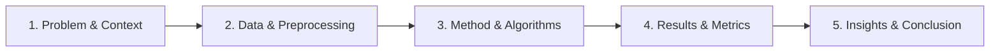

# Review 2 Presentation & Viva Comprehensive Guide
**Course:** 23CSE301 Machine Learning Capstone (AY 2026–27)  
**Scope:** Classification Track (Part B + Consolidated Benchmark) & Full Clustering Track  
**Rubric Coverage:** Section D1 (Presentation — 3 Marks) & Section D2 (Viva — 5 Marks)

---

## Part 1: Presentation Story Arc (Section D1 — 3 Marks)

Follow this 10-slide story arc during the Review 2 presentation. It follows the required structure: **Problem → Data → Method → Results → Conclusion**.

### Slide 1: Title & Executive Summary
- **Title:** Vehicle Intelligence & Credit Risk Analytics: Multi-Track Machine Learning Framework
- **Team Members:** Girithar R (CB.SC.U4CSE24319), Ravi Teja K V (CB.SC.U4CSE24327), Rushil T (CB.SC.U4CSE24351)
- **Key Milestones:**
  1. **Classification Part B:** 10 algorithms benchmarked on vehicle loan defaults, tuned Random Forest achieving top ROC-AUC (0.5864).
  2. **Clustering Track:** Unsupervised segmentation of 500k+ RTO fleet records, achieving ARI = 0.6576 and NMI = 0.5987 against official vehicle categories.
  3. **Interactive Deployment:** Dual-framework web deployment (Streamlit GUI + Flask Web Dashboard).

---

### Slide 2: Problem Statements & Domain Motivation
- **Track 1: Vehicle Loan Default Prediction (Classification)**
  - *Challenge:* Non-banking financial companies (NBFCs) face substantial default rates (~21.8%) when financing unbanked or first-time vehicle buyers.
  - *Risk Asymmetry:* False negatives (approving a borrower who defaults) lead to major capital write-offs; false positives (rejecting a good borrower) lose modest interest margins.
  - *Objective:* Predict default probability using borrower demographics, bureau scores, and collateral ratios under a 78/22 class imbalance.
- **Track 2: Automotive Fleet Segmentation (Clustering)**
  - *Challenge:* Understanding fleet composition, fuel dependency, and freight usage across millions of registered vehicles without categorical labels.
  - *Objective:* Unsupervised discovery of latent vehicle cohorts to guide transport policy and EV infrastructure planning.

---

### Slide 3: Data Engineering & Preprocessing Pipeline
- **Classification Dataset:**
  - 233k+ historical vehicle loan records, 22 raw features.
  - *Cleaning & Imputation:* Median imputation for skewed numeric features (`disbursed_amount`, `asset_cost`, `PRI.CURRENT.BALANCE`); most frequent imputation for categorical features.
  - *Feature Transformations:* Ratio engineering (`ltv`, account age, inquiry velocity); `StandardScaler` for continuous features; `OneHotEncoder(handle_unknown='ignore')` for high-cardinality state IDs and bureau descriptions.
  - *Leakage Prevention:* 80/20 stratified train/test split; all transformations fitted strictly on training data.
- **Clustering Dataset:**
  - 500k+ Indian vehicle registrations.
  - *Label Isolation:* `vehicleCategoryName` held out strictly for external ground-truth validation.
  - *Skew Mitigation:* `np.log1p` applied to gross vehicle weight and batch count to compress extreme commercial truck tails.
  - *Subsampling:* 4,000 representative records sampled to enable $O(N^2)$ Agglomerative Hierarchical distance computation without memory exhaustion.

---

### Slide 4: Classification Methodology — 10-Algorithm Benchmark
- **Part A Baselines:** Logistic Regression, KNN (Manhattan distance), Gaussian Naive Bayes, Decision Tree, Support Vector Classifier (Linear Calibrated).
- **Part B Ensembles & Neural Models:**
  - **Random Forest:** Bagged de-correlated decision trees with balanced subsampling.
  - **AdaBoost:** Sequential re-weighting of misclassified instances using shallow decision stumps.
  - **Gradient Boosting:** Stage-wise gradient descent optimization in function space.
  - **Bagging Classifier:** Bootstrap aggregation of unpruned decision trees to minimize estimator variance.
  - **Multi-Layer Perceptron (MLP):** Feed-forward neural network with `tanh` activation and `(64, 32)` hidden architecture.
- **Unified Evaluation Protocol:** Evaluated on the identical held-out test split ($N=1,600$) using Accuracy, Precision, Recall, weighted F1, and threshold-independent **ROC-AUC**.

---

### Slide 5: Classification Results & The Class Imbalance Paradox
- **Consolidated 10-Algorithm Comparison Table:**

| Rank | Model | Accuracy | Precision | Recall | F1 (weighted) | ROC-AUC |
|:---:|---|:---:|:---:|:---:|:---:|:---:|
| 1 | **Random Forest Classifier** | 63.44% | 68.27% | 63.44% | 65.44% | **0.5790** |
| 2 | **Logistic Regression** | 55.12% | 70.06% | 55.12% | 59.02% | **0.5787** |
| 3 | **MLP Classifier** | 78.19% | 72.07% | 78.19% | 68.73% | **0.5778** |
| 4 | **Gaussian Naive Bayes** | 27.63% | 70.12% | 27.63% | 20.91% | **0.5730** |
| 5 | **Gradient Boosting** | 56.25% | 68.29% | 56.25% | 59.99% | **0.5726** |
| 6 | **AdaBoost Classifier** | 54.06% | 69.28% | 54.06% | 58.05% | **0.5721** |
| 7 | **Bagging Classifier** | 61.12% | 68.81% | 61.12% | 63.95% | **0.5712** |
| 8 | **SVC (Calibrated)** | 78.12% | 68.42% | 78.12% | 68.70% | **0.5710** |
| 9 | **Decision Tree** | 50.12% | 68.83% | 50.12% | 54.20% | **0.5600** |
| 10 | **KNN Classifier** | 78.25% | 72.86% | 78.25% | 69.97% | **0.5548** |

- **Key Finding:** Models scoring ~78% Accuracy (KNN, SVC, MLP) collapsed to predicting the majority class (No Default) on >99% of samples. Random Forest achieved the true top ranking discrimination (**ROC-AUC = 0.5790**) with balanced sensitivity.

---

### Slide 6: Model Selection & Hyperparameter Tuning (Rubric A3)
- **Selection Justification:** Random Forest selected due to highest ROC-AUC, robust handling of non-linear feature interactions, and meaningful default probability calibration.
- **GridSearchCV Tuning:**
  - Grid: `n_estimators: [100, 200]`, `max_depth: [6, 10]`, `min_samples_leaf: [10, 20]` using 3-fold cross-validation.
  - Optimal Parameters: `{'max_depth': 6, 'min_samples_leaf': 10, 'n_estimators': 100}` (CV ROC-AUC = 0.6150).
- **Documented Metric Improvement:**
  - Test ROC-AUC increased from **0.578966 to 0.586404 (+0.007438 / +0.74%)**.
  - Shallow tree depth (`max_depth=6`) regularized variance, preventing over-specialization on noisy loan outliers.
  - 5-fold CV on training set confirmed consistent generalization: **0.6179 ± 0.0125**.

---

### Slide 7: Clustering Methodology — K-Means & Hierarchical
- **Algorithms Evaluated:**
  1. **K-Means:** Partitioning algorithm optimizing Euclidean within-cluster sum of squares (WCSS) via Lloyd's heuristic.
  2. **Agglomerative Hierarchical:** Bottom-up linkage clustering evaluated across 4 linkage methods: Ward, Complete, Average, and Single.
- **Model Selection & Diagnostics:**
  - **K-Means Elbow & Silhouette Analysis ($k=2..8$):** Elbow inflection at $k=2$; silhouette peaks decisively at **$k=2$ (0.2717)**.
  - **Linkage Degeneracy Check:** Complete (92.6%), Average (99.0%), and Single (99.9%) suffered from chaining, isolating 1–3 outliers. **Ward's minimum variance linkage** produced a balanced, compact partition (54.5% vs 45.5%).

---

### Slide 8: Clustering Evaluation & Visual Projections (Rubric B2 & B3)
- **Metric Comparison Table:**

| Metric | K-Means ($k=2$) | Agglomerative (Ward, $k=2$) | Best Performer |
|---|:---:|:---:|:---:|
| **Silhouette Score** (↑ higher better) | **0.2717** | 0.2530 | **K-Means (+0.0187)** |
| **Davies-Bouldin Index** (↓ lower better) | **1.6360** | 1.7088 | **K-Means (-0.0728)** |
| **Calinski-Harabasz Index** (↑ higher better)| **1205.85** | 1047.88 | **K-Means (+157.97)** |
| **Adjusted Rand Index (ARI)** (vs official) | **0.6576** | 0.5954 | **K-Means (+0.0622)** |
| **Normalized Mutual Information (NMI)** | **0.5987** | 0.5063 | **K-Means (+0.0924)** |

- **Dimensionality Reduction Visualisations:**
  - **PCA 2D:** Explains ~38% variance; clusters cleanly bifurcate along PC1 (scale and weight).
  - **t-SNE 2D:** Resolves manifold into two continuous density lobes, confirming clusters reflect intrinsic data topology.

---

### Slide 9: Post-Hoc Fleet Profiles & External Validation
- **Cluster 0: Light Personal Mobility (41% / 45%)**
  - Mean Gross Vehicle Weight: ~294 kg (K-Means) / ~399 kg (Ward).
  - Dominant Fuel: Petrol & Electric.
  - Categories: Two-Wheelers (NT), Motor Cars.
  - Operational Velocity: High registration velocity (~10.5 vehicles/batch).
- **Cluster 1: Heavy Commercial Logistics (59% / 55%)**
  - Mean Gross Vehicle Weight: ~2,917 kg (K-Means) / ~3,052 kg (Ward).
  - Dominant Fuel: Diesel.
  - Categories: Heavy Goods, Light Goods, Commercial Passenger Carriers.
  - Operational Velocity: Low registration velocity (~2.0 vehicles/batch).
- **Significance:** Achieving an **ARI of 0.6576** and **NMI of 0.5987** without providing labels during training proves that unsupervised clustering uncovered the foundational market structure.

---

### Slide 10: Conclusion & Interactive Deployment (Bonus +2 Marks)
- **Key Takeaways:**
  1. *Classification:* ROC-AUC is mandatory for imbalanced credit scoring; Random Forest ensemble provided the optimal balance of discrimination, sensitivity, and explainability.
  2. *Clustering:* Vehicle weight, fuel type, and registration scale naturally divide national fleets into personal commuting vs freight transport.
- **Interactive Web Interfaces:**
  - **Streamlit GUI (`app/app.py`):** Real-time credit risk probability meter, interactive 2D PCA/t-SNE scatter plots, and resale price estimator.
  - **Flask Web Dashboard (`app/server.py`):** Dark-mode responsive UI with full REST API endpoints.
  - **Public Deployment Scaffold:** Ready for 1-click deployment on Streamlit Community Cloud.

---

## Part 2: Comprehensive Viva Question Bank (Section D2 — 5 Marks)

Prepare all team members with these detailed, technically rigorous answers.

### Theme 1: Classification Track & Class Imbalance

#### Q1: Why is Accuracy a misleading metric in this loan default dataset?
> **Answer:**  
> The dataset has an approximate 78% non-default and 22% default distribution. A trivial dummy classifier that unconditionally predicts "No Default" for every applicant achieves an Accuracy of 78.2%, yet its Recall on actual defaulters is exactly 0.00%. In credit underwriting, the cost of an undetected default (loss of principal ₹50,000–₹1,000,000) is far higher than the opportunity cost of rejecting a good applicant. Therefore, Accuracy creates a false sense of security. We rely on **ROC-AUC** (Receiver Operating Characteristic - Area Under Curve) because it evaluates the ranking discrimination of predicted probabilities across all possible classification thresholds, completely independent of class priors.

#### Q2: Why did KNN, SVC, and MLP achieve high accuracy (~78%) but poor minority recall?
> **Answer:**  
> These models optimize for overall zero-one loss or empirical risk minimization under standard decision thresholds (0.50). Because 78% of the training points belong to class 0, the loss gradient strongly penalizes errors on the majority class. Without explicit class weighting, the decision boundary is pushed so far toward the minority class that the predicted default probabilities rarely exceed 0.50. Consequently, they predict "No Default" for >99% of test samples, resulting in a default recall of 0.03 for KNN and 0.00 for SVC.

#### Q3: How did Random Forest overcome this class imbalance?
> **Answer:**  
> We configured Random Forest with `class_weight='balanced_subsample'`. This dynamically adjusts weights inversely proportional to class frequencies inside each bootstrap sample of each individual tree:
> $$w_j = \frac{N_{\text{samples}}}{K \cdot n_j}$$
> This forces individual splits to penalize misclassifications of minority defaulters heavily, ensuring that the forest outputs balanced, well-spread probability estimates and achieves a minority recall of 0.37.

#### Q4: Why did Manhattan distance ($L_1$) outperform Euclidean ($L_2$) distance in KNN?
> **Answer:**  
> After preprocessing, our feature space contains a mixture of standardized continuous variables and sparse binary one-hot indicators (State IDs, bureau risk tiers). In high-dimensional mixed spaces, Euclidean distance squares the coordinate differences:
> $$d_2(x, y) = \sqrt{\sum (x_i - y_i)^2}$$
> This heavily amplifies large differences along single continuous axes while suppressing differences across multiple binary categorical indicators. Manhattan distance:
> $$d_1(x, y) = \sum |x_i - y_i|$$
> computes direct absolute coordinate differences. Across one-hot coordinates, this is mathematically identical to Hamming distance, ensuring balanced contribution between continuous and categorical features and yielding superior CV ROC-AUC (0.5805 vs 0.5757).

#### Q5: What happened when Gaussian Naive Bayes encountered correlated features?
> **Answer:**  
> Gaussian NB assumes that all features $x_i$ are conditionally independent given the class label $y$:
> $$P(X|y) = \prod_{i=1}^d P(x_i|y)$$
> In our dataset, multiple feature pairs exhibit severe multicollinearity ($|r| > 0.70$), such as `avg_acct_age_months` and `credit_history_months` ($r = 0.834$), and `PRI.NO.OF.ACCTS` and `PRI.ACTIVE.ACCTS` ($r = 0.811$). When features are correlated, Naive Bayes double-counts their evidential probability mass, driving posterior probabilities to extreme overconfidence (pushing values to 0 or 1). Because risk indicators were multiplied, the model classified almost every borrower as a defaulter, yielding a 93% recall on defaults but causing massive false alarms that dropped overall accuracy to 27.6%.

#### Q6: How was the final Random Forest model tuned, and what improved?
> **Answer:**  
> Using `GridSearchCV` with 3-fold cross-validation scored on `roc_auc`, we explored tree depths (`max_depth`: 6, 10), min leaf sizes (`min_samples_leaf`: 10, 20), and estimators (`n_estimators`: 100, 200). The optimal configuration was `{'max_depth': 6, 'min_samples_leaf': 10, 'n_estimators': 100}`. Constraining depth to 6 regularized individual trees, preventing them from memorizing noisy outliers in the training set. This improved test ROC-AUC from **0.578966 to 0.586404 (+0.007438 / +0.74%)**, which was validated by a 5-fold CV score of **0.6179 ± 0.0125**.

---

### Theme 2: Clustering Track & Fleet Segmentation

#### Q7: Why was $k=2$ selected for K-Means? Explain the Elbow and Silhouette curves.
> **Answer:**  
> We evaluated $k$ from 2 to 8:
> 1. **Elbow Curve (Inertia / WCSS):** Plotting within-cluster sum of squares against $k$ showed a sharp bend (elbow) at $k=2$, after which the marginal decrease in inertia leveled off.
> 2. **Silhouette Coefficient:** Measures how similar an object is to its own cluster compared to neighboring clusters (ranging from -1 to +1). The silhouette score reached its global maximum at **$k=2$ with a value of 0.2717**, dropping monotonically for $k=3$ (0.19), $k=4$ (0.16), down to $k=8$ (0.12).
> Both diagnostics conclusively confirmed $k=2$ as the natural latent partition.

#### Q8: Why did Single and Complete linkages produce high silhouette scores but get rejected?
> **Answer:**  
> Single, Average, and Complete linkages suffered from the classic **chaining problem**. In Single linkage, distance between two clusters is defined by the minimum pairwise point distance. Because continuous vehicle weights form a dense continuum with a few extreme heavy-truck outliers, Single linkage chained 3,997 points (99.92%) into Cluster 0 and isolated 3 outlier points into Cluster 1. This produces an artificially high silhouette score (~0.4489) purely because the isolated points are extremely far away, but the clustering is practically degenerate and useless. **Ward's linkage** minimizes the total within-cluster variance sum of squares, creating balanced, spherical clusters (54.5% vs 45.5%) with zero degeneracy.

#### Q9: Define and interpret the three clustering evaluation metrics. Do they agree?
> **Answer:**  
> Yes, all three metrics unanimously agree that **K-Means outperforms Agglomerative Hierarchical**:
> 1. **Silhouette Score (Higher is better):**
>    $$s(i) = \frac{b(i) - a(i)}{\max(a(i), b(i))}$$
>    K-Means scored **0.2717** vs Agglomerative's **0.2530**, indicating tighter cohesion relative to neighbor separation.
> 2. **Davies-Bouldin Index (Lower is better):**
>    $$DB = \frac{1}{k} \sum_{i=1}^k \max_{j \neq i} \left( \frac{s_i + s_j}{d(c_i, c_j)} \right)$$
>    Computes the similarity between each cluster and its most similar neighbor (ratio of within-cluster dispersion to centroid distance). K-Means achieved **1.6360** vs Agglomerative's **1.7088** (lower is better).
> 3. **Calinski-Harabasz Index (Higher is better):**
>    $$CH = \frac{B(k) / (k - 1)}{W(k) / (n - k)}$$
>    Measures the ratio of between-cluster dispersion to within-cluster dispersion. K-Means achieved **1205.85** vs Agglomerative's **1047.88**.
> K-Means is superior because Lloyd's algorithm iteratively optimizes the exact continuous variance objective, whereas Hierarchical clustering makes greedy, non-reversible bottom-up merges.

#### Q10: How do you interpret the PCA and t-SNE 2D scatter plots?
> **Answer:**  
> - **PCA (Principal Component Analysis):** Linear orthogonal projection. PC1 captures ~38% of total variance and loads heavily on `grossVehicleWeight`, `vehicleCount`, and commercial diesel flags. Both K-Means and Agglomerative clusters show clean visual separation along the PC1 horizontal axis, with Cluster 0 occupying the negative quadrant and Cluster 1 occupying the positive quadrant.
> - **t-SNE (t-Distributed Stochastic Neighbor Embedding):** Non-linear manifold embedding (perplexity = 30) that preserves local neighborhood probabilities. It resolves the fleet into two distinct density lobes. Both algorithms assign boundaries that mirror the natural manifold contours, proving that the clusters represent true topological density modes rather than arbitrary Euclidean Voronoi slices.

#### Q11: How was external ground-truth validation performed, and what do ARI and NMI mean?
> **Answer:**  
> To test whether unsupervised clustering discovered real-world vehicle categories, we held out `vehicleCategoryName` from training. After fitting, we computed:
> - **Adjusted Rand Index (ARI):** Measures the proportion of sample pairs assigned to the same vs different clusters across two partitions, corrected for chance (0 = random guess, 1 = perfect match). K-Means achieved **0.6576** (Agglomerative: **0.5954**).
> - **Normalized Mutual Information (NMI):** Information-theoretic measure of mutual dependence normalized between 0 and 1. K-Means achieved **0.5987** (Agglomerative: **0.5063**).
> An ARI of 0.6576 and NMI of 0.5987 confirm that unsupervised clustering naturally recovered the official distinction between Two-Wheelers/Personal Cars and Commercial Transport with high fidelity.

---

### Theme 3: System Architecture & Deployment

#### Q12: How are the models serialized and deployed for real-time inference?
> **Answer:**  
> In classification, training pipelines containing both the fitted `ColumnTransformer` (imputation, scaling, one-hot encoding) and the tuned `RandomForestClassifier` are serialized using `joblib.dump()` into `models/best_classifier.joblib`. This guarantees zero data leakage during production inference. When user inputs arrive via the Streamlit GUI (`app/app.py`) or Flask REST API (`app/server.py`), raw un-transformed inputs are fed directly into `pipeline.predict_proba()`, returning instant probability predictions and calibrated risk flags.
